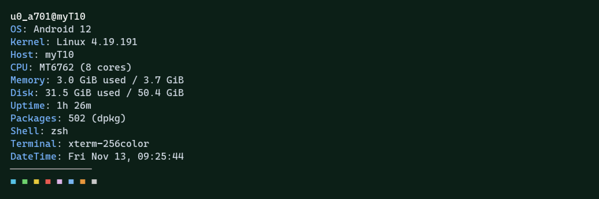

# Plusafetch

A modular **C++23** system fetch tool for **Termux (Android, unrooted)** with a **Linux** fallback.
Fastfetch-style module registry, zero-allocation string buffers, parallel detection, single-write output.
**No logo. Ever.** Text and data only.

> Status: v0.1.0 · text-only · MIT

## Example



Rendered with [`scripts/ansi2png.py`](scripts/ansi2png.py), a tiny terminal-emulator → PNG renderer (numpy + Pillow) that turns captured ANSI output into a pixel-perfect screenshot — no browser required. Capture with `plusafetch --color > out.ansi`, render with `python3 scripts/ansi2png.py out.ansi screenshot.png`.

## Build

### Termux (Android)

```sh
pkg install clang cmake termux-api   # termux-api optional but recommended
git clone https://github.com/Mark44928/plusafetch.git
cd plusafetch
./install.sh
```

### Linux

```sh
git clone https://github.com/Mark44928/plusafetch.git
cd plusafetch
./install.sh                   # apt/dnf/pacman; installs clang + cmake
```

Or manually:

```sh
cmake -B build -DCMAKE_BUILD_TYPE=Release .
cmake --build build -j2
cmake --install build          # installs to <prefix>/bin; honors --prefix=, e.g. $HOME/.local
plusafetch
```

## Usage

| Command | Effect |
| --- | --- |
| `plusafetch` | default layout (fast: syscalls + files only) |
| `plusafetch --all` | adds termux-api modules (Android): battery, sensors, telephony, wifi, clipboard, command, gpu |
| `plusafetch --json` | JSON dump of detected modules (`null` when a module is Unsupported) |
| `plusafetch --format '{os}\n{cpu}\n{memory}'` | template; placeholders `{name}`, slices `{os~0,5}` |
| `plusafetch --modules os,cpu,battery` | comma-separated module list |
| `plusafetch --values-only` | print values only (no key column) |
| `plusafetch --gen-config` | write JSONC config (atomic, see below) |
| `plusafetch --list-modules` | list every registered module |
| `plusafetch --notify` | send a Termux notification when done (Android only) |
| `plusafetch --no-color` | disable colors (auto when `COLORTERM` is absent) |

### Example `--format`

```sh
plusafetch --format 'os={os} cpu={cpu} mem={memory}'
```

### Config (`$HOME/.config/plusafetch/config.jsonc`)

JSONC with comments (stripped before strict parsing). `$XDG_CONFIG_HOME` is honored; `PLUSAFETCH_CONFIG` overrides the path. Config writes use `mkstemp()` in `$TMPDIR` (0600) + `rename()`.

```jsonc
{
  // display order of modules
  "modules": ["title","os","kernel","host","cpu","memory","disk","uptime",
              "packages","shell","terminal","datetime","separator","colors"],
  // per-module key rename: {"name": "cpu", "key": "Processor"} (render + JSON)
  "colors": true,      // master switch
  "truecolor": true,   // 24-bit ANSI (\\033[38;2;R;G;Bm)
  "keyColor": "#78b4ff", // hex RGB (or [r,g,b]) for the key column
  "boldKeys": false,   // bold key labels
  "hideKeys": false,   // values-only mode (like --values-only)
  "separatorLength": 14, // Separator module dash count (0..200)
  //"command": "date", // Command module: sh -c string, first line is printed
  //"commandKey": "Uptime" // label for the Command module
}
```

## What shows up where

**Core modules (all platforms, no subprocesses):** title, os*, kernel, host*, cpu, memory, disk, uptime, packages, shell, terminal, locale, datetime, separator, colors.

\* Android (Termux): `Os` from `ro.build.version.release` via the NDK property service (`__system_property_get`), `Host/Title` from `ro.product.model` — no subprocess. Linux: `/etc/os-release` and `gethostname()`.

| Module | Source | If unavailable |
| --- | --- | --- |
| OS | `/etc/os-release` (Linux) / NDK props (Android) | `N/A` |
| Kernel | `uname()` | `N/A` |
| CPU | `/proc/cpuinfo` (`model name`/`Hardware`/`Processor` + core count) | `N/A` |
| Memory | `/proc/meminfo` (`MemTotal`/`MemAvailable`) | `N/A` |
| Disk | Android: `statvfs("/data")` · Linux: `statvfs("/")` | `N/A` |
| Uptime | `CLOCK_BOOTTIME` (kernel boot time incl. suspend — works unrooted); falls back to `/proc/uptime` | `N/A` |
| Packages | dpkg `status` paragraphs / `rpm -qa` | `N/A` |
| Shell/Terminal/Locale/DateTime | env / `std::time` | `N/A` |
| Battery | `/sys/class/power_supply/*` (Linux/Android, fast); `termux-battery-status` (Android fallback) | `N/A` |
| Sensors | `termux-sensor -l` → `-s <name> -n 1` exact-name wishlist (accel, light, proximity, gyro) | `N/A` |
| Telephony | `termux-telephony-deviceinfo` | `N/A` |
| WiFi | `termux-wifi-connectioninfo` (surfaces `API_ERROR` if location off) | `N/A` |
| Brightness | Android: **always N/A** — `termux-brightness` is write-only; Linux: best-effort `/sys/class/backlight/*` | `N/A` |
| Clipboard | `termux-clipboard-get` (Android) / `xclip` (Linux) | `N/A` |
| GPU | Linux only: `lspci -d ::0300 -nn` | `N/A` ← printed as N/A on Android |

**Privacy:** we never print `device_id`, `sim_serial_number`, `sim_subscriber_id` (Android restricts these anyway), WiFi BSSID/MAC, or anything else personal. Battery/telephony/wifi values are shown, not logged.

## Performance

Default layout does **zero subprocesses** — everything is a `uname()`/`statvfs()`/bounded file read (plus one `opendir`-free dpkg parse of a few hundred KiB) — and detection fans out over `std::jthread`. On an unrooted MediaTek Helio P22, median wall time from process start to single `write()` is **≈23 ms** (measured 22–30 ms over 30 runs). Independent modules (CPU, Memory, Disk, Battery…) each write only their own `FFContext` slot before the render phase joins.

> The <15 ms aspiration is not fully met including process startup on this device class; the detection phase itself is sub-millisecond. `--all` (Android) spawns long-lived termux-api subprocesses and runs them in parallel — total ≈0.5 s, by design, and the default path never pays for them.

## Constraints met / deliberate exclusions

- C++23, `clang++`/`g++ -std=c++23 -O3 -pthread`, stdlib + POSIX only (no fmt/boost/…).
- `nlohmann/json` vendored in `third_party/nlohmann/` (MIT).
- `std::expected` everywhere; no exceptions in business logic; no `assert()`.
- A–Z registry indexed via `toupper(name[0]) - 'A'`; `FFModuleBaseInfo` carries `name`, `displayName`, `description`, `initOptions`, `destroyOptions`, `parseJsonObject`, `detect`, `moduleValue`, `printModule`, `generateJsonResult`, `generateJsonConfig`, `formatArgs`.
- `FFstrbuf { length; allocated; chars }` — static-literal fast path, power-of-two growth, RAII cleanup.
- **No logo**, no network calls, no telemetry, no config-write without `--gen-config`.

## Build requirements

- Termux: `pkg install clang cmake termux-api` (install script does this)
- Linux: `clang` or `g++` + `cmake` (CI checks both, plus Apple Clang on macOS)


## 🛠️ More from Mark44928

Tiny, dependency-free tools from the same family:

- [Plusalator](https://github.com/Mark44928/Plusalator) — C++17 calculator REPL — Qalculate-flavored, ghost autosuggest, 18 themes
- [GrubBlastersHTML](https://github.com/Mark44928/GrubBlastersHTML) — Worms-style artillery in one HTML file — 70 weapons, fully destructible terrain
- [SnakTUI](https://github.com/Mark44928/SnakTUI) — modern Snake for your terminal — Textual + Python
- [Easy-Termux-Package-Manager](https://github.com/Mark44928/Easy-Termux-Package-Manager) — fzf-driven package manager for Termux — snapshots, audit, 183 tests
- [NoNameOS](https://github.com/Mark44928/NoNameOS) — OS simulation in a single C++17 file — virtual FS, real shell
- [Greenit](https://github.com/Mark44928/Greenit) — green-injected theme family — dark + light, single palette.json
- [CalculaHTML](https://github.com/Mark44928/CalculaHTML) — static HTML calculator — 15 themes + System mode, zero deps
- [android12-fastfetch](https://github.com/Mark44928/android12-fastfetch) — fastfetch config for Android 12 + native X11 Termux desktops
- [Anti-bloatware-list-for-Android-TV-Boxes-and-Sticks-for-rooted](https://github.com/Mark44928/Anti-bloatware-list-for-Android-TV-Boxes-and-Sticks-for-rooted) — ADB debloat for rooted Android 9+ TV sticks & boxes
- [Android9-audios](https://github.com/Mark44928/Android9-audios) — 217 stock Android 9 system sounds + per-file SHA-256

## License

MIT — see [LICENSE](LICENSE). Research notes: [RESEARCH.md](RESEARCH.md).
Third-party notices: [THIRD_PARTY_NOTICES.md](THIRD_PARTY_NOTICES.md).

## Contributing

See [CONTRIBUTING.md](CONTRIBUTING.md). Security reports: [SECURITY.md](SECURITY.md).
